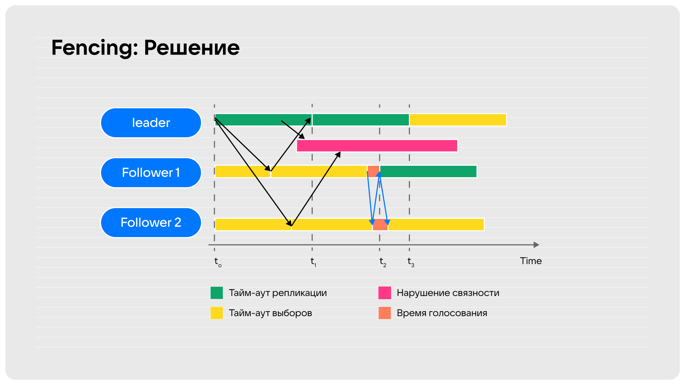

.. _raft:

Raft
====

Raft is the consensus algorithm used by Tarantool for synchronous
replication. It elects a leader, tracks terms and votes, and controls who
owns the synchronous transaction queue. The journal-replication mechanics
built on top of Raft are described in :ref:`synchronous_replication`.

How Raft works in general
-------------------------

Raft is a consensus algorithm designed to ensure fault-tolerance and
consistency in distributed systems. The primary goal of the Raft
consensus algorithm is to ensure that a cluster of servers agrees on
a sequence of log entries, representing a shared state machine. In
our case this shared state machine is a replicated database.

Raft achieves consensus by electing a **leader** among the servers in
the cluster. The leader is responsible for accepting client requests,
processing them, and replicating the resulting state changes to other
servers. The other servers in the cluster act as **followers**, which
simply replicate the leader's log entries and respond to client requests
forwarded by the leader.

To maintain consistency, Raft uses a replicated log as the core mechanism.
The leader receives client requests, appends them to its own log, and then
broadcasts the log entries to the followers for replication. Once a majority
of followers acknowledge the receipt and persistence of the log entries,
the leader considers them committed and notifies the followers to apply the
changes to their state machines. This ensures that all replicas eventually
reach the same state.

Raft operates through a series of terms, each consisting of a single
leader election. Terms are time-based and identified by monotonically
increasing numbers. If a leader fails or disconnects, a new leader is
elected in the subsequent term through an election process. The leader
can be elected only if more then half of the nodes voted for him. The
node, which noticed the death of the leader, enters **candidate** state
and starts elections, incrementing term.

Overall, the Raft consensus algorithm provides a clear and understandable
approach to distributed consensus. It simplifies the design and implementation
of distributed systems by providing a fault-tolerant foundation for maintaining
consistency and availability in a cluster of servers.

Unfortunately, Raft consensus works great only in paper, but it's not enough
to just follow specification to ensure cluster operability in case of partial
loss of connection between nodes. Moreover, election time is pretty
significant due to the possibility of an equal number of votes for diffirent
nodes during election process. In order to solve these problemes, Tarantool
applies several tweaks to the canonical implementation of Raft algorithm:
PreVote, Fencing, Split-Vote and Split-Brain detection. They are described in
the following `habr article`_ and `here`_.

Canonical design of Raft can be found in Raft `paper`_, extended version -
in Diego's `dissertation`_. You can also check out the `article`_, which
describes Raft and the specifics of its implementations.

Implementation of election process
----------------------------------

Raft structure
~~~~~~~~~~~~~~

Now we know, how synchronous replication works, it's time to get into implementation
of the elections. The Raft is represented by the following structure:

.. code-block:: c

    struct raft {
        /** Instance ID of this node. */
        uint32_t self;
        /** Instance ID of leader of the current term. */
        uint32_t leader;
        /** State of the instance. */
        enum raft_state state;
        /**
         * Volatile part of the Raft state, whose WAL write may be still
         * in-progress, and yet the state may be already used. Volatile state is
         * never sent to anywhere, but the state machine makes decisions based
         * on it. That is vital.
         */
        uint64_t volatile_term;
        uint32_t volatile_vote;
        /**
         * Flag whether Raft is enabled. When disabled, it still persists terms
         * so as to quickly enroll into the cluster when (if) it is enabled. In
         * everything else disabled Raft does not affect instance work.
         */
        bool is_enabled;
        /**
         * Flag whether the node can become a leader. It is an accumulated value
         * of configuration options Raft enabled and Raft candidate. If at least
         * one is false - the instance is not a candidate.
         */
        bool is_candidate;
        /** Flag whether the instance is allowed to be a leader. */
        bool is_cfg_candidate;
        /**
         * Flag whether Raft currently tries to write something into WAL. It
         * happens asynchronously, not right after Raft state is updated.
         */
        bool is_write_in_progress;
        /**
         * Flag whether Raft wants to broadcast its state.
         */
        bool is_broadcast_scheduled;
        /**
         * Persisted Raft state.
         */
        uint64_t term;
        uint32_t vote;
        /** Statistics which node voted for who. */
        struct raft_vote votes[VCLOCK_MAX];
        /** How many nodes voted in the current term. */
        int voted_count;
        /** Max vote count given to any node in the current term. */
        int max_vote;
        /** A bitmap of sources which see the leader of the current term. */
        vclock_map_t leader_witness_map;
        /** Number of votes necessary for successful election. */
        int election_quorum;
        /**
         * Vclock of the Raft node owner. Raft never changes it, only watches,
         * and makes decisions based on it. The value is not stored by copy so
         * as to avoid frequent updates.
         */
        const struct vclock *vclock;
        /**
         * Vclock of the candidate which the current instance is trying to vote
         * for right now. It is used to double-check if the instance still can
         * vote for the given candidate after own WAL queue was flushed.
         */
        struct vclock candidate_vclock;
        /** State machine timed event trigger. */
        struct ev_timer timer;
        /** The moment of the last communication with the leader. */
        double leader_last_seen;
        /** Configured election timeout in seconds. */
        double election_timeout;
        /**
         * Leader death timeout, after which it is considered dead and new
         * elections can be started.
         */
        double death_timeout;
        /** Maximal deviation from the election timeout. */
        double max_shift;
        /** Number of instances registered in the cluster. */
        int cluster_size;
        /** Virtual table to perform application-specific actions. */
        const struct raft_vtab *vtab;
        /**
         * Trigger invoked each time any of the Raft node visible attributes are
         * changed.
         */
        struct rlist on_update;
    };

election_mode = OFF
~~~~~~~~~~~~~~~~~~~

Firstly, let's see how raft works, when election_mode option equals OFF.
All nodes that have values other than off run the Raft state machine internally
talking to other nodes according to the Raft leader election protocol. When the
option is off, the node accepts Raft messages from other nodes, but it doesn’t
participate in the election activities, and this doesn’t affect the node’s state.
But even if the instance have ``election_mode = 'off'``, then it still won't be
writable, as it doesn't own the limbo. If there is a Raft leader, then it owns
the limbo. Hence the other nodes won't be writable.

When Tarantool starts, ```box_raft_init`` is called:

.. code-block:: c

     main
         box_init
             box_raft_init
                 static const struct raft_vtab box_raft_vtab = {
                     .broadcast = box_raft_broadcast,
                     .write = box_raft_write,
                     .schedule_async = box_raft_schedule_async,
                     .node_to_string = box_raft_node_to_string,
                 };
                 raft_create(&box_raft_global, &box_raft_vtab);
                 trigger_create(&box_raft_on_update, box_raft_on_update_f, NULL, NULL);
                 raft_on_update(box_raft(), &box_raft_on_update);

                 trigger_create(&box_raft_on_quorum_change, box_raft_on_quorum_change_f,
                            NULL, NULL);
                 box_register_watcher("box.wal_error", ...,
                            box_raft_on_wal_error_f, ...);
                 box_raft_on_election_event =
                            event_get("box.ctl.on_election", true);

Note, that box.cfg has not been called yet, initialization process takes place right now.
``box_raft_init`` invokes ``raft_create`` (we'll take a look at its work below), which
creates Raft node and initializes ``struct raft`` (described above). After this we add
a trigger ``box_raft_on_update_f``, which is invoked each time any of the Raft node
visible attributes are changed (in ``raft_schedule_broadcast``):

.. code-block:: c

    static int
    box_raft_on_update_f(struct trigger *trigger, void *event)
    {
        struct raft *raft = (struct raft *)event;
        box_update_ro_summary();
        box_broadcast_election();
        /*
         * Once the node becomes read-only due to a new term, it should
         * stop finalizing existing synchronous transactions so that it
         * doesn't trigger split-brain with the new leader.
         */
        txn_limbo_update_state(&txn_limbo);
        if (raft->state != RAFT_STATE_LEADER)
            return 0;
        box_raft_schedule_async(raft);
        return 0;
    }


It is used in order to broadcast state to subsystems on the same node. It makes the node
read-only, when the instance becomes a follower, broadcast results of the new elections,
clears synchro queue, when the node becomes a leader.

``box_raft_on_quorum_change_f`` is also created, but isn't added yet. These are the triggers,
which are invoked, when replicaset's instances connects or disconnects. They change
`is_candidate` flag and fence Raft (see Pre-Vote and Fencing parts).

Let's return to ``raft_create`` function:

.. code-block:: c

     void
     raft_create(struct raft *raft, const struct raft_vtab *vtab)
     {
         *raft = (struct raft) {
             .state = RAFT_STATE_FOLLOWER,
             .volatile_term = 1,
             .term = 1,
             .election_quorum = 1,
             .election_timeout = 5,
             .death_timeout = 5,
             .max_shift = 0.1,
             .cluster_size = VCLOCK_MAX,
             .vtab = vtab,
         };
         raft_ev_timer_init(&raft->timer, raft_sm_election_update_cb, 0, 0);
         raft->timer.data = raft;
         rlist_create(&raft->on_update);
     }

Note, that ``vtab`` is not copied, so it should not be freed before ``raft_destroy``.
``struct raft`` is initialized with default values. ``ev_timer_init`` is invoked with
*after* and *repeat* parameters equal to 0, so ``raft_sm_election_update_cb`` is
called only once, after which it's not restarted.

.. code-block:: c

    static void
    raft_sm_election_update_cb(struct ev_loop *loop, struct ev_timer *timer, int events)
        ...
        raft_schedule_broadcast(raft);
            raft_schedule_async(raft);
            if (box_raft_worker == NULL) {
                box_raft_worker = fiber_new_system("raft_worker",
                                                    box_raft_worker_f);
            ...

The only function, which is not no-op during the initialization of Raft is
``raft_schedule_broadcast``, which starts a worker fiber responsible for
processing async work:

.. code-block:: c

    static int
    box_raft_worker_f(va_list args)
    {
        (void)args;
        struct raft *raft = fiber()->f_arg;
        assert(raft == box_raft());
        while (!fiber_is_cancelled()) {
            fiber_check_gc();
            box_raft_has_work = false;

            raft_process_async(raft);
            box_raft_update_synchro_queue(raft);

            if (!box_raft_has_work)
                fiber_yield();
        }
        return 0;
    }

The WAL write and broadcast scheduling are now handled inside
``raft_process_async`` (``src/lib/raft/raft.c``).

We consider initialization done, ``election_mode`` is set to OFF now via
``box_raft_cfg_election_mode``:

.. code-block:: c

    void
    box_raft_cfg_election_mode(enum election_mode mode)
    {
        struct raft *raft = box_raft();
        if (mode == box_election_mode)
            return;
        box_election_mode = mode;
        switch (mode) {
        case ELECTION_MODE_OFF:
        case ELECTION_MODE_VOTER:
            box_raft_remove_quorum_triggers();
            raft_cfg_is_candidate(raft, false);
            break;
        case ELECTION_MODE_MANUAL:
            box_raft_add_quorum_triggers();
            /*
             * If the node already was the leader, don't disrupt its
             * current leadership. It doesn't contradict the manual mode.
             */
            raft_cfg_is_candidate_later(raft, false);
            break;
        case ELECTION_MODE_CANDIDATE:
            box_raft_add_quorum_triggers();
            if (box_raft_has_healthy_quorum())
                raft_cfg_is_candidate(raft, true);
            break;
        default:
            unreachable();
        }
        box_raft_update_election_quorum();
        txn_limbo_update_state(&txn_limbo);
    }

Raft is enabled/disabled separately: ``raft_cfg_is_enabled(box_raft(), true)``
is called from ``box_raft_finish_recovery()`` once recovery is over.

After the execution of this function we'll have ``is_enabled = false`` and
``is_candidate = false``. Even though Raft is disabled, we still can accept Raft messages
via ``raft_process_msg``, which updates term, writes it to storage and broadcast to other
known nodes in replicaset (this is why we needed to start Raft worker fiber). So, raft
state is updated and goes to WAL when necessary, but it does not affect the instance operation.
As Raft is stopped, the instance role does not affect whether it is writable (see state
machine description below).

election_mode = CANDIDATE
~~~~~~~~~~~~~~~~~~~~~~~~~

Let's move to the more sophisticated case, where election works as usual, the node can vote
for the others, and can also become a leader. ``VOTER`` case differs only in the fact, that
the nodes cannot become a leader.

We initialize the Raft with the same process, we did with ``OFF`` option. But after
``box_raft_cfg_election_mode`` we'll have ``is_enabled = true`` and ``is_candidate = true``.
``raft_cfg_is_enabled`` functions not just set flag, it starts state machine:

.. code-block:: c

    void
    raft_cfg_is_enabled(struct raft *raft, bool is_enabled)
    {
        if (is_enabled == raft->is_enabled)
            return;

        if (!is_enabled)
            raft_sm_stop(raft);
        else
            raft_sm_start(raft);
    }

State machine is started for any election mode other then ``OFF``. If state machine is stopped,
the instance can't vote or become a leader, Raft doesn't affect instance operation.

.. code-block:: c

    static void
    raft_sm_start(struct raft *raft)
    {
        say_info("raft: start state machine");
        raft->is_enabled = true;
        raft->is_candidate = raft->is_cfg_candidate;

        if (raft->is_write_in_progress) {
        } else if (raft_is_leader_seen(raft)) {
            raft_sm_wait_leader_dead(raft);
        } else if (raft->is_candidate && raft->leader_witness_map == 0) {
            raft_sm_wait_leader_found(raft);
        }

        raft_schedule_broadcast(raft);
    }

Firstly, let's consider the case, in which the current instance has seen a leader in the
current term, which means, that ``raft_sm_wait_leader_dead`` is executed. This function
waits for death of the current leader and tries to start new election:

.. code-block:: c

    static void
    raft_sm_wait_leader_dead(struct raft *raft)
    {
        raft_ev_timer_set(&raft->timer, raft->death_timeout, raft->death_timeout);
        raft_ev_timer_start(raft_loop(), &raft->timer);
    }

It starts the timer which will execute ``raft_sm_election_update_cb`` (remember
``raft_create``, we set this callback there) after ``death_timeout`` if it manages to end.
Let's see what happens in such situation:

.. code-block:: c

    static void
    raft_sm_election_update_cb(struct ev_loop *loop, struct ev_timer *timer,
                   int events)
    {
        struct raft *raft = timer->data;
        raft_ev_timer_stop(loop, timer);
        bit_clear(&raft->leader_witness_map, raft->self);
        raft_restore(raft);
        raft_schedule_broadcast(raft);
        raft_sm_election_update(raft);
    }

``bit_clear`` is used in PreVote, ``raft_restore`` in ``election_mode = MANUAL`` (see parts
below). At the last stage we try to start election process with ``raft_sm_election_update``.
If we manage to pass all checks, we bump the term and vote for ourselves, after which we
dump the state to the disk:

.. code-block:: c

    raft_sm_election_update(struct raft *raft)
        raft_sm_schedule_new_election(raft);
            raft_sm_schedule_new_term(raft, raft->volatile_term + 1);
            raft_sm_schedule_new_vote(raft, raft->self, raft->vclock);

.. code-block:: c

    static void
    raft_sm_schedule_new_term(struct raft *raft, uint64_t new_term)
    {
        say_info("RAFT: bump term to %llu, follow", (long long)new_term);
        raft->volatile_term = new_term;
        /* New terms means completely new Raft state. */
        raft->volatile_vote = 0;
        vclock_clear(&raft->candidate_vclock);
        ...
        raft->leader_witness_map = 0;
        ...
        raft_sm_pause_and_dump(raft);
        raft_schedule_broadcast(raft);
    }

.. code-block:: c

    static void
    raft_sm_schedule_new_vote(struct raft *raft, uint32_t candidate_id,
                  const struct vclock *candidate_vclock)
    {
        say_info("RAFT: vote for %u, follow", candidate_id);
        raft->volatile_vote = candidate_id;
        vclock_copy(&raft->candidate_vclock, candidate_vclock);
        raft_add_vote(raft, raft->self, candidate_id);
        raft_sm_pause_and_dump(raft);
            if (raft->is_write_in_progress)
                return;
            raft_ev_timer_stop(raft_loop(), &raft->timer);
            raft_schedule_async(raft);
            raft->is_write_in_progress = true;
    }

As we can see we set ``is_write_in_progress`` flag and scheduled async request.
It's time to get back to out worker fiber, which invokes ``raft_worker_handle_io``
in case of ``is_write_in_progress``:

.. code-block:: c

    static void
    raft_worker_handle_io(struct raft *raft)
    {
        struct raft_msg req;

        if (raft_is_fully_on_disk(raft)) {
    end_dump:
            raft->is_write_in_progress = false;
            if (raft_is_leader_seen(raft) && raft->is_enabled) {
                raft_sm_wait_leader_dead(raft);
            } else if (raft->is_candidate) {
                if (raft->vote == raft->self) {
                    if (raft->election_quorum == 1)
                        raft_sm_become_leader(raft);
                    else
                        raft_sm_become_candidate(raft);
                } else if (raft->vote != 0) {
                    raft_sm_wait_election_end(raft);
                } else {
                    raft_sm_schedule_new_vote(raft, raft->self,
                                  raft->vclock);
                }
            }
        } else {
            memset(&req, 0, sizeof(req));
            if (raft->volatile_vote == 0)
                goto do_dump;
            if (raft->volatile_vote == raft->self)
                goto do_dump_with_vote;
            if (raft->volatile_term > raft->term)
                goto do_dump;
            if (!raft_can_vote_for(raft, &raft->candidate_vclock)) {
                say_info("RAFT: vote request for %u is canceled - the "
                     "vclock is not acceptable anymore",
                     raft->volatile_vote);
                raft_revoke_vote(raft);
                assert(raft_is_fully_on_disk(raft));
                goto end_dump;
            }
    do_dump_with_vote:
            req.vote = raft->volatile_vote;
    do_dump:
            req.term = raft->volatile_term;
            raft_write(raft, &req);
            say_info("RAFT: persisted state %s", raft_msg_to_string(&req));

            assert(req.term >= raft->term);
            raft->term = req.term;
            raft->vote = req.vote;
            raft_schedule_broadcast(raft);
            if (raft_is_fully_on_disk(raft))
                goto end_dump;
        }
    }

The second part of the function (after else) is executed firstly, in it we form
a request, which may include volatile_term or/and volatile_vote. Note, that in case
of writing a vote for other node, the function persists new term and vote separately,
using 2 WAL writes. Writing the term first is needed to flush all the ongoing
transactions, so that the node's vclock is updated and can be checked against the
candidate's vclock. Otherwise it could happen that the node persists a vote for some
candidate only to find that it's vclock would actually become incomparable with the
candidate's.

Actually, this guard is not needed when checking a vote for self, because a node can
always vote for self. Besides, splitting term bump and vote can lead to increased
probability of split-vote. It may happen that a candidate bumps and broadcasts the new
term without a vote, making other nodes vote for self. So, term and vote are written
together for self votes.

As soon as we save request to the storage (``raft_write``), we make volatile
term and vote persistent and broadcast the changed state, after which the first
part of the function (``end_dump``) is executed.

But before moving forward, let's see, how ``broadcast`` works. As we remember, broadcasts
are processed by raft worker fiber with ``raft_worker_handle_broadcast`` function:

.. code-block:: c

    static void
    raft_worker_handle_broadcast(struct raft *raft)
    {
        assert(raft->is_broadcast_scheduled);
        struct raft_msg req;
        raft_checkpoint_remote(raft, &req);

        raft_broadcast(raft, &req);
            struct raft_request req;
            box_raft_msg_to_request(msg, &req);
            replicaset_foreach(replica)
                relay_push_raft(replica->relay, &req);
            trigger_run(&box_raft_on_broadcast, NULL);

        raft->is_broadcast_scheduled = false;
    }

.. note::
   Before the appearance of Raft, the only function of the relay was to send journal entries.
   With the implementation of synchronous replication (we discussed this process in
   `Synchronous replication of the journal` part) it was possible to ensure that all
   replicas receive the system message simply by writing it to the journal. In this case,
   no additional functionality needed to be added to the relay. It continued to forward
   entries from the journal to the replica.

   In the case of implementing Raft, this trick did not work. Firstly, not all Raft system
   messages should be included in the journal, which means that the relay will have nowhere
   to read them from. Secondly, even the messages that do get into the journal, such as the
   current term number and the vote, should not be blindly applied by the replica. It should
   learn about the term change and the vote cast, but it is not obliged to vote in the same
   way as another node. Therefore, it was necessary to teach the relay to send arbitrary
   messages to the replicas upon request. It does this during breaks between sending journal
   portions.

   So, ``relay_push_raft`` and ``applier_handle_raft`` (and others) were introduced.
   For details see :ref:`replication` and ':ref:`relay` internal docs.

On the side of the follower raft message is processed with ``raft_process_msg``, the work
of which is decribed below. Let's get back to ``raft_worker_handle_io``. As we voted for
ourselves, we'll enter CANDIDATE state:

.. code-block:: c

    static void
    raft_sm_become_candidate(struct raft *raft)
    {
        say_info("RAFT: enter candidate state with 1 self vote");
        raft->state = RAFT_STATE_CANDIDATE;
        raft_sm_wait_election_end(raft);
        raft_schedule_broadcast(raft);
    }

And now we wait until the election is timed out with ``raft_sm_wait_election_end``.
When it happens, the node will start new election (``raft_sm_election_update_cb``).

.. code-block:: c

    static void
    raft_sm_wait_election_end(struct raft *raft)
    {
        double election_timeout = raft->election_timeout +
                      raft_new_random_election_shift(raft);
        raft_ev_timer_set(&raft->timer, election_timeout, election_timeout);
        raft_ev_timer_start(raft_loop(), &raft->timer);
        raft_check_split_vote(raft);
    }

Note, that ``election_timeout`` is randomized, which is stated in Raft specification.
Raft uses randomized election timeouts to ensure that split votes are rare and that
they are resolved quickly. To prevent split votes, election timeouts are chosen randomly
from a fixed interval. This spreads out the servers so that in most cases only a single
server will time out; it wins the election and sends heartbeats before any other servers
time out.

The timer is started, so it's time to figure out, how we followers will process
vote request. It's done via ``raft_proccess_msg``:

.. code-block:: c

    int
    raft_process_msg(struct raft *raft, const struct raft_msg *req, uint32_t source)
    {
        say_info("RAFT: message %s from %u", raft_msg_to_string(req), source);
        if (req->term == 0 || req->state == 0 || req->state >= raft_state_MAX) {
            diag_set(RaftError, "Invalid term or state");
            return -1;
        }
        if (req->state == RAFT_STATE_CANDIDATE &&
            (req->vote != source || req->vclock == NULL)) {
            diag_set(RaftError, "Candidate should always vote for self and "
                 "provide its vclock");
            return -1;
        }
        if (req->term < raft->volatile_term) {
            say_info("RAFT: the message is ignored due to outdated term - "
                 "current term is %llu",
                 (long long)raft->volatile_term);
            return 0;
        }

        raft_process_term(raft, req->term, source);
        raft_notify_is_leader_seen(raft, req->is_leader_seen, source);

        if (req->vote != 0) {
            if (raft_add_vote(raft, source, req->vote))
                raft_check_split_vote(raft);

            switch (raft->state) {
            case RAFT_STATE_FOLLOWER:
            case RAFT_STATE_LEADER:
                if (!raft->is_enabled) {
                    say_info("RAFT: vote request is skipped - RAFT "
                         "is disabled");
                    break;
                }
                if (raft->leader != 0) {
                    say_info("RAFT: vote request is skipped - the "
                         "leader is already known - %u",
                         raft->leader);
                    break;
                }
                if (req->vote == raft->self) {
                    say_info("RAFT: vote request is skipped - "
                         "can't accept vote for self if not a "
                         "candidate");
                    break;
                }
                if (req->state != RAFT_STATE_CANDIDATE) {
                    say_info("RAFT: vote request is skipped - "
                         "this is a notification about a vote "
                         "for a third node, not a request");
                    break;
                }
                if (raft->volatile_vote != 0) {
                    say_info("RAFT: vote request is skipped - "
                         "already voted in this term");
                    break;
                }
                raft_sm_try_new_vote(raft, req->vote, req->vclock);
                break;
            case RAFT_STATE_CANDIDATE:
                if (req->vote != raft->self) {
                    say_info("RAFT: vote request is skipped - "
                         "competing candidate");
                    break;
                }
                int vote_count = raft_vote_count(raft);
                if (vote_count < raft->election_quorum) {
                    say_info("RAFT: accepted vote for self, vote "
                         "count is %d/%d", vote_count,
                         raft->election_quorum);
                    break;
                }
                raft_sm_become_leader(raft);
                break;
            default:
                panic("RAFT: unreacheable state hit");
                break;
            }
        }
        if (req->state != RAFT_STATE_LEADER) {
            if (source == raft->leader) {
                say_info("RAFT: the node %u has resigned from the "
                     "leader role", raft->leader);
                raft->leader = 0;
                bit_clear(&raft->leader_witness_map, raft->self);
                raft_ev_timer_stop(raft_loop(), &raft->timer);
                raft_schedule_broadcast(raft);
                if (raft->is_cfg_candidate)
                    raft_sm_schedule_new_election(raft);
            }
            return 0;
        }
        if (source == raft->leader)
            return 0;
        if (raft->leader != 0) {
            say_warn("RAFT: conflicting leader detected in one term - "
                 "known is %u, received %u", raft->leader, source);
            return 0;
        }

        bool changed = raft_leader_see(raft);
        raft_sm_follow_leader(raft, source);
        return 0;
    }

As we remember, our CANDIDATE bumped term, so, ``raft_process_term`` will schedule
bumping of the term on the follower too. Moreover, the vote is also will be != 0
(request with self-vote is broadcasted alongside with term). According to the fact,
that we are in FOLLOWER state, we'll try to schedule vote for the instance, which
requested a vote, with ``raft_sm_try_new_vote``:

.. code-block:: c

    static void
    raft_sm_try_new_vote(struct raft *raft, uint32_t candidate_id,
                 const struct vclock *candidate_vclock)
    {
        if (!raft_can_vote_for(raft, candidate_vclock)) {
            assert(candidate_id != raft->self);
            say_info("RAFT: vote request for %u is skipped - the vclock "
                 "is not acceptable", candidate_id);
            return;
        }
        raft_sm_schedule_new_vote(raft, candidate_id, candidate_vclock);
    }

This'll create async request for voting, which'll be processed by raft worker, bumped
to the disk and broadcasted to all followers, including the node, which requested vote.

Let's now move to the CANDIDATE, which is waiting on ``raft_sm_wait_election_end``, as
we remember, and figure out, how it knows, that it's time to become a leader. FOLLOWER
voted for our CANDIDATE and broadcasted a request. It's still process with the same
``raft_process_msg``. But we are in CANDIDATE state, so the other switch case works:

.. code-block:: c

    raft_process_msg(struct raft *raft, const struct raft_msg *req, uint32_t source)
        ...
        if (raft_add_vote(raft, source, req->vote))
            raft_check_split_vote(raft);
        ...
        case RAFT_STATE_CANDIDATE:
            if (req->vote != raft->self) {
                say_info("RAFT: vote request is skipped - "
                     "competing candidate");
                break;
            }
            int vote_count = raft_vote_count(raft);
            if (vote_count < raft->election_quorum) {
                say_info("RAFT: accepted vote for self, vote "
                     "count is %d/%d", vote_count,
                     raft->election_quorum);
                break;
            }
            raft_sm_become_leader(raft);
            break;

With ``raft_add_vote`` we increment the number of nodes, which voted for a ``req->vote``.
In our case, the node voted for us. After that we call ```raft_vote_count``, which returns
the number of nodes, which voted for us. If this value is more or equal to the election
quorum (configured with ``replication_synchro_timeout``), then we call
``raft_sm_become_leader``:

.. code-block:: c

    static void
    raft_sm_become_leader(struct raft *raft)
    {
        say_info("RAFT: enter leader state with quorum %d",
             raft->election_quorum);
        raft->state = RAFT_STATE_LEADER;
        raft->leader = raft->self;
        raft_ev_timer_stop(raft_loop(), &raft->timer);
        raft_schedule_broadcast(raft);
    }

Now we broadcast the message to the local node and to our followers. On
``raft_schedule_broadcast``  ``box_raft_on_update_f`` is called, which executes
``box_update_ro_summary``:

.. code-block:: c

    void
    box_update_ro_summary(void)
    {
        bool old_is_ro_summary = is_ro_summary;
        is_ro_summary = is_ro || is_orphan || is_waiting_for_own_rows ||
                box_raft_is_ro();
        /* In 99% nothing changes. Filter this out first. */
        if (is_ro_summary == old_is_ro_summary)
            return;
        if (is_ro_summary) {
            struct txn *txn;
            rlist_foreach_entry(txn, &txns, in_txns) {
                if (txn->n_new_rows != 0 &&
                    txn->n_new_rows != txn->n_local_rows &&
                    txn->status == TXN_INPROGRESS) {
                    txn_abort_with_conflict(txn);
                    txn_set_flags(txn, TXN_IS_ABORTED_RO_NODE);
                }
            }
            say_info("box switched to read-only - %s", box_ro_state_msg());
        }
        fiber_cond_broadcast(&ro_cond);
        box_broadcast_status();
        box_broadcast_election();
        box_broadcast_ballot();
    }

It makes the instance writable, after which the message is broadcasted further.
When this message from ``raft_sm_become_leader`` is broadcasted to the FOLLOWER, it
calls ``raft_sm_follow_leader`` during the same ``raft_process_msg``:

.. code-block:: c

    static void
    raft_sm_follow_leader(struct raft *raft, uint32_t leader)
    {
        say_info("RAFT: leader is %u, follow", leader);
        raft->state = RAFT_STATE_FOLLOWER;
        raft->leader = leader;
        if (!raft->is_write_in_progress && raft->is_enabled) {
            raft_ev_timer_stop(raft_loop(), &raft->timer);
            raft_sm_wait_leader_dead(raft);
        }
        raft_schedule_broadcast(raft);
    }

It transits to the FOLLOWER state (even if it was in any othee state at this moment)
and starts a timer, which tries to start an elections (``raft_sm_wait_leader_dead``).

This timer can be reset, when heartbeat from the leader is received (relay is
responsible for sending heartbeats). Heartbeat is processed with the following function:

.. code-block:: c

    void
    raft_process_heartbeat(struct raft *raft, uint32_t source)
    {
        ...
        if (raft_is_leader_seen(raft) ||
            (raft->is_candidate && raft->leader_witness_map == 0)) {
            assert(raft_ev_timer_is_active(&raft->timer));
            raft_ev_timer_stop(raft_loop(), &raft->timer);
        }

        raft_leader_see(raft);
        raft_sm_wait_leader_dead(raft);
    }

election_mode = MANUAL
~~~~~~~~~~~~~~~~~~~~~~

When an instance is configured with the ``election_mode = MANUAL``, it behaves as
follows:

 - By default, the instance acts like a voter – it is read-only and may vote for
   other instances that are candidates.
 - Once box.ctl.promote() is called, the instance becomes a candidate and starts
   a new election round. If the instance wins the elections, it becomes a leader,
   but won’t participate in any new elections.

After ``box_raft_cfg_election_mode`` we'll have ``is_enabled = true`` and
``is_candidate = false``:

.. code-block:: c

    void
    box_raft_cfg_election_mode(enum election_mode mode)
    {
        box_election_mode = mode;
        switch (mode) {
        ...
        case ELECTION_MODE_MANUAL:
            box_raft_add_quorum_triggers();
            if (raft->state == RAFT_STATE_LEADER ||
                raft->state == RAFT_STATE_CANDIDATE) {
                raft_cfg_is_candidate_later(raft, false);
            } else {
                raft_cfg_is_candidate(raft, false);
            }
            break;
        ...
        raft_cfg_is_enabled(raft, mode != ELECTION_MODE_OFF);
    }

According to the fact, that raft is enabled, we'll be able to vote for candidates
in ``raft_process_msg`` (see this function above). But automatic elections cannot
be started:

.. code-block:: c

    static void
    raft_sm_election_update_cb(struct ev_loop *loop, struct ev_timer *timer,
                   int events)
    {
        ...
        /* If this was a manual promotion, transition back to follower. */
        raft_restore(raft);
        raft_schedule_broadcast(raft);
        raft_sm_election_update(raft);
            if (!raft->is_cfg_candidate)
                return;
            ...
    }

When any kind of timer ends, ``raft_sm_election_update`` is no-op, because the current
node in not a candidate. Moreover, the node transition back to the follower state:

.. code-block:: c

    void
    raft_restore(struct raft *raft)
    {
        raft_set_candidate(raft, raft->is_cfg_candidate && raft->is_enabled);
    }

Manual promotion is done using the function ``box_promote``, which calls
``box_raft_try_promote``:

.. code-block:: c

    int
    box_promote(void)
    {
        if (!is_box_configured)
            return 0;
        if (box_check_promote() != 0)
            return -1;
        struct raft *raft = box_raft();
        if (box_election_mode == ELECTION_MODE_VOTER) {
            diag_set(ClientError, ER_UNSUPPORTED, "election_mode='voter'",
                     "manual elections");
            return -1;
        }
        /*
         * Currently active leader (the instance that is seen as leader by
         * both raft and txn_limbo) can't issue another PROMOTE.
         */
        if (txn_limbo.state == TXN_LIMBO_STATE_LEADER)
            return 0;
        if (box_raft_try_promote() != 0)
            return -1;
        return box_wait_for_rw_while_leader(raft);
    }

When the current node becomes leader, its worker writes promote:

.. code-block:: c

    box_raft_worker_f(va_list args)
    {
        ...
        while (!fiber_is_cancelled()) {
            raft_process_async(raft);
            box_raft_update_synchro_queue(raft);
                ...
                rc = box_promote_qsync();
                    ...
                    return txn_limbo_promote(&txn_limbo,
                                             IPROTO_RAFT_PROMOTE,
                                             TIMEOUT_INFINITY);
            ...
        }
        return 0;
    }

.. code-block:: c

    int
    box_raft_try_promote(void)
    {
        ...
        struct box_raft_watch_ctx ctx = {
            .is_done = false,
            .term = raft->volatile_term,
            .owner = fiber(),
        };
        trigger_create(&trig, box_raft_try_promote_f, &ctx, NULL);
        raft_on_update(raft, &trig);
        ...
        if (raft->state == RAFT_STATE_LEADER)
            return 0;
        raft_restore(raft);
        ...
        return -1;
    }

After invoking ``raft_promote`` the function waits, until the leader is elected
using the trigger ``box_raft_try_promote_f``. Let's see how ``raft_promote`` behaves:

.. code-block:: c

    void
    raft_promote(struct raft *raft)
    {
        if (!raft->is_enabled)
            return;
        raft_sm_schedule_new_term(raft, raft->volatile_term + 1);
        raft_start_candidate(raft);
        raft_sm_schedule_new_vote(raft, raft->self, raft->vclock);
    }

The function just makes the current node the CANDIDATE and starts new election process,
bumping term, voting for itself and requesting votes from other followers.

When the user do ``box.ctl.demote()``,

.. code-block:: c

    int
    box_demote(void)
    {
        if (!is_box_configured)
            return 0;
        if (box_check_promote() != 0)
            return -1;
        is_in_box_promote = true;
        auto promote_guard = make_scoped_guard([&] {
            is_in_box_promote = false;
        });
        if (box_election_mode != ELECTION_MODE_OFF) {
            box_raft_leader_step_off();
            return 0;
        }
        if (txn_limbo.state == TXN_LIMBO_STATE_INACTIVE)
            return 0;
        /*
         * If Raft term went further than the limbo, it might indicate
         * ongoing elections. Only allow persistent demotion when this
         * instance actually owns the limbo in the latest known Raft term.
         */
        struct raft *raft = box_raft();
        uint64_t limbo_term = txn_limbo.term;
        if (limbo_term < raft->volatile_term ||
            txn_limbo.queue.owner_id != instance_id) {
            diag_set(ClientError, ER_NOT_LEADER, raft->leader);
            return -1;
        }
        raft_new_term(raft);
        uint64_t raft_term = raft->volatile_term;
        if (box_raft_wait_term_persisted() != 0)
            return -1;
        if (raft->volatile_term != raft_term || txn_limbo.term != limbo_term) {
            diag_set(ClientError, ER_INTERFERING_ELECTIONS);
            return -1;
        }
        return txn_limbo_promote(&txn_limbo, IPROTO_RAFT_DEMOTE,
                                 replication_synchro_timeout);
    }

The function bumps the term, making the current node a FOLLOWER, when any kind of
Raft's timer ends, ``raft_restore`` is called, which removes ``is_candidate`` flag
and doesn't allow the current node to start new elections.

PreVote
~~~~~~~

Let's imagine that in our cluster consist of nodes A, B, and C, node C has completely
lost communication with the others. Server A is the leader, connected to server B, and
can process write requests. So far, so good.

Server C will initiate new elections every election_timeout. However, it won't be able to
win any of them since it won't gather a majority of votes. But its term will keep increasing
indefinitely, and when connectivity is restored, server A will resign, seeing a higher term.
The cluster will transit to a read-only state for at least one election round without any
apparent reason for it.

The issue of such disruptive servers is also discussed by Diego Ongaro, the author of Raft,
in his `dissertation`_. However, he mentions them in the context of configuration changes.
The solution proposed by the author of Raft is a new election phase called Pre-Vote. The idea
is that each server, before starting the actual elections, sends a "mock" vote request called
PreVote to all other servers. This PreVote request contains the same fields as a regular
RequestVote, and the recipient server responds to it following the same rules as for RequestVote.
The only difference is that the recipient server does not increment its term upon receiving this
request and responds negatively or simply ignores the request if it already sees a leader in
the current term.

The candidate increments its term and initiates the actual elections only after receiving
confirmation that the majority of the servers are willing to vote for it.

Tarantool applies another solution: all replicas communicate with each other to determine
whether they see the leader. By gathering information about who sees the leader and who does not,
the node can make a decision on whether to start elections. If at least one replica sees the
leader or if there is no communication with the majority, we don't start elections.

Let's figure out how it's implemented. New election can be started, if it have enough quorum of
connected peers and if none of the peers sees the old leader:

.. code-block:: c

    static inline void
    raft_sm_election_update(struct raft *raft)
    {
        if (!raft->is_cfg_candidate)
            return;
        if (raft->leader_witness_map != 0)
            return;

        raft_sm_schedule_new_election(raft);
    }

``is_cfg_candidate`` flag shows whether the current node have enough quorum to start election.
When applier's health changes ``replica_update_applier_health`` executes:

.. code-block:: c

    static void
    replica_update_applier_health(struct replica *replica)
    {
        struct applier *applier = replica->applier;
        bool is_healthy = applier != NULL && applier->state == APPLIER_FOLLOW;
        if (is_healthy == replica->is_applier_healthy)
            return;
        replica->is_applier_healthy = is_healthy;
        if (!replica->is_relay_healthy || replica->anon)
            return;
        if (is_healthy)
            replicaset.healthy_count++;
        else
            replicaset.healthy_count--;

        replicaset_on_health_change();
        if (!is_healthy && replica->id != REPLICA_ID_NIL)
            raft_notify_is_leader_seen(box_raft(), false, replica->id);
    }

``replicaset_on_health_change`` runs triggers, related to quorum gain or loss (remember, that
we set these triggers during Raft initialization). Function ``box_raft_notify_have_quorum``
is invoked:

.. code-block:: c

    static void
    box_raft_notify_have_quorum(void)
    {
        struct raft *raft = box_raft();
        bool has_healthy_quorum = box_raft_has_healthy_quorum();
        if (box_raft_election_fencing_paused && has_healthy_quorum)
            box_raft_election_fencing_resume();

        switch (box_election_mode) {
        case ELECTION_MODE_MANUAL:
            assert(!raft->is_cfg_candidate);
            if (!has_healthy_quorum)
                box_raft_fence();
            break;
        case ELECTION_MODE_CANDIDATE:
            if (has_healthy_quorum) {
                raft_cfg_is_candidate(raft, true);
            } else if (raft->state == RAFT_STATE_CANDIDATE ||
                   raft->state == RAFT_STATE_LEADER) {
                box_raft_fence();
                raft_cfg_is_candidate_later(raft, false);
            } else {
                raft_cfg_is_candidate(raft, false);
            }
            break;
        case ELECTION_MODE_OFF:
        case ELECTION_MODE_VOTER:
        default:
            unreachable();
        }
    }

It sets ``is_cfg_candidate`` flag according to the quorum. So, no election will be started until
we connects to the number of nodes, which is more or equal to the quorum.

``leader_witness_map`` check is a little bit more complex. Every Raft message includes additional
field ``is_leader_seen``:

.. code-block:: c

    static void
    box_raft_msg_to_request(const struct raft_msg *msg, struct raft_request *req,
                            enum group_id group_id)
    {
        *req = (struct raft_request) {
            .term = msg->term,
            .vote = msg->vote,
            .leader_id = msg->leader_id,
            .is_leader_seen = msg->is_leader_seen,
            .state = msg->state,
            .group_id = group_id,
        };
        if (msg->vclock != NULL)
            vclock_copy(&req->vclock, msg->vclock);
        else
            vclock_clear(&req->vclock);
    }

So, when we receive a message, broadcasted from the other node, we process this field:

.. code-block:: c

    int
    raft_process_msg(struct raft *raft, const struct raft_msg *req, uint32_t source)
    {
        ...
        /* Notification from a remote node that it sees the current leader. */
        raft_notify_is_leader_seen(raft, req->is_leader_seen, source);
        ...
        raft_leader_see(raft);
        ...
    }

The bit in ``leader_witness_map`` is set by ``raft_notify_is_leader_seen``, if the
corresponding follower stated that it sees the leader:

.. code-block:: c

    void
    raft_notify_is_leader_seen(struct raft *raft, bool is_leader_seen,
                               uint32_t source)
    {
        /* Leader doesn't care whether someone sees it or not. */
        if (raft->state == RAFT_STATE_LEADER)
            return;
        if (is_leader_seen)
            bit_set(&raft->leader_witness_map, source);
        else if (bit_clear(&raft->leader_witness_map, source))
            raft_sm_election_update(raft);
    }

We also set this bit for our own node and broadcast the state, if the bit was
changed, via ``raft_leader_see``:

.. code-block:: c

    static bool
    raft_leader_see(struct raft *raft)
    {
        uint32_t source = raft->self;
        bool was_seen = bit_set(&raft->leader_witness_map, source);
        raft->leader_last_seen = raft_ev_monotonic_now(raft_loop());
        if (!was_seen) {
            raft_schedule_broadcast(raft);
            return true;
        }
        return false;
    }

Note, that ``raft_process_heartbeat`` also calls ``raft_leader_see``. If any of
the bits from this map is set we don't start elections.

Also note, that when timer ends, the bit, which corresponds to the current node, is
cleared (we didn't receive any heartbeat from the leader during death_timeout, which
equals to 4 * ``replication_timeout`` in general) and we try to start election:

.. code-block:: c

    static void
    raft_sm_election_update_cb(struct ev_loop *loop, struct ev_timer *timer,
                   int events)
    {
        ...
        bit_clear(&raft->leader_witness_map, raft->self);
        ...
        raft_sm_election_update(raft);
    }

Fencing
~~~~~~~

In the situation where one leader already exists, it is still possible to have multiple
nodes considering themselves leaders in different terms simultaneously (Raft can garantee
only the fact, that in one term we'll have only one leader). However, it is desirable to
avoid this scenario because only one leader can perform synchronous writes.

Let's assume we have one leader in term 15 and another leader in term 16. The situation with
two leaders can only occur when the old leader loses communication with the majority of
servers in the cluster. Indeed, since winning an election requires obtaining a majority of
votes, the only scenario where the old leader would not be aware of the election is if it
lacks communication with the majority. If it were connected to at least one server that
voted for the new leader, it would immediately step down from its leadership role (see
``raft_process_msg -> raft_process_term``).

It would be highly undesirable if our users continue to send requests to both leaders depending
on the client's configuration. In such a case, if we have synchronous replication, one of the
leaders' writes will fail. If we have asynchronous replication, there may be a data conflict
when writing to both nodes simultaneously.

The solution to this problem is to resign the leader, when it sees, that the node cannot
communicate with the majority of nodes. The problem here, when should we resign.

Let's consider an example with three nodes, where the leader is writing something. After a
certain period of time, the write reaches Follower 1 and Follower 2, and they send confirmation
responses.



Suppose the leader receives the confirmation response right at the end of the replication timeout (t1).
However, Follower 1 starts its election timeout earlier, during the response transmission. Let's
assume that after this, a network partition occurs. When the election timeout expires, Follower 1
initiates an election. Since there is no network connectivity, Follower 1 and Follower 2 can quickly
reach an agreement by the time t2 (the blue arrows represent interaction) since we attempted to
expedite the election. Between t2 and t3, when the leader's replication timeout expires, there are two
leaders simultaneously in the cluster, which is undesirable.

Let's consider an extreme case where the message from the leader to the follower travels very quickly,
while the return message takes exactly the duration of the timeout. This means that the leader will
receive the message just at the end of its legitimate period. Therefore, to avoid starting new elections
while the leader can still consider itself legitimate, we need to have a doubled timeout, which we have
implemented. If we set the timeout for followers to be twice as long, then the re-election process will
begin after the leader has already relinquished its leadership. So, "Fencing" was introduced.

Three modes of fencing are supported:

.. code-block:: c

    enum election_fencing_mode {
        ELECTION_FENCING_MODE_INVALID = -1,
        ELECTION_FENCING_MODE_OFF = 0,
        ELECTION_FENCING_MODE_SOFT = 1,
        ELECTION_FENCING_MODE_STRICT = 2,
    };

``ELECTION_FENCING_MODE_OFF`` - leader won't resign leadership when quorum is lost.
``ELECTION_FENCING_MODE_SOFT`` - leader will resign leadership when quorum is lost. Quite possible it
will happen after new leader is already elected.
``ELECTION_FENCING_MODE_STRICT`` - leader will resign leadership when quorum is lost, it will resign
before automatic elections should start in any part of cluster
(assuming replication_timeout is same on every replica).


Fencing mode affects on the timeout, returned by ``replication_disconnect_timeout``:

.. code-block:: c

    double
    replication_disconnect_timeout(void)
    {
        struct raft *raft = box_raft();
        if (raft != NULL && raft->state == RAFT_STATE_LEADER &&
            box_election_fencing_mode == ELECTION_FENCING_MODE_STRICT)
            return replication_timeout * 2;
        return replication_timeout * 4;
    }

``death_timeout`` in Raft is set using this function:

.. code-block:: c

    void
    box_set_replication_timeout(void)
    {
        ...
        raft_cfg_death_timeout(box_raft(), replication_disconnect_timeout());
        ...
    }

If timeout passes and no heartbeats from the leader are received, new elections are started. But
for the FOLLOWER this timeout equals ``replication_timeout * 4``, if strict fencing is enabled.
The leader is supposed to notice connection problems and resign before this time in case of
strict fencing. This is done via setting the timeout ``replication_timeout * 2`` for applier reader:

.. code-block:: c

    static int
    applier_thread_reader_f(va_list ap)
    {
        ...
        while (!fiber_is_cancelled()) {
            FiberGCChecker gc_check;
            double timeout = applier->version_id < version_id(1, 7, 7) ?
                     TIMEOUT_INFINITY :
                     replication_disconnect_timeout();
            ...
            applier_read_tx(applier, &tx->rows, &ctx, timeout);
            ...

    }

When timeout passes, the applier is considered to be dead and ``box_raft_notify_have_quorum`` is
executed:

.. code-block:: c

    static void
    box_raft_notify_have_quorum(void)
    {
        struct raft *raft = box_raft();
        bool has_healthy_quorum = box_raft_has_healthy_quorum();
        if (box_raft_election_fencing_paused && has_healthy_quorum)
            box_raft_election_fencing_resume();

        switch (box_election_mode) {
        case ELECTION_MODE_MANUAL:
            /* Quorum loss shouldn't interfere with manual elections. */
            assert(!raft->is_cfg_candidate);
            if (!has_healthy_quorum)
                box_raft_fence();
            break;
        case ELECTION_MODE_CANDIDATE:
            if (has_healthy_quorum) {
                raft_cfg_is_candidate(raft, true);
            } else if (raft->state == RAFT_STATE_CANDIDATE ||
                   raft->state == RAFT_STATE_LEADER) {
                box_raft_fence();
                raft_cfg_is_candidate_later(raft, false);
            } else {
                raft_cfg_is_candidate(raft, false);
            }
            break;
        case ELECTION_MODE_OFF:
        case ELECTION_MODE_VOTER:
        default:
            unreachable();
        }
    }

If we cannot connect to the quorum, we resign from the leader state, which makes
the limbo leave ``TXN_LIMBO_STATE_LEADER`` and stop writing CONFIRMs:

.. code-block:: c

    static void
    box_raft_fence(void)
    {
        struct raft *raft = box_raft();
        if (raft->state != RAFT_STATE_LEADER ||
            box_election_fencing_mode == ELECTION_FENCING_MODE_OFF ||
            box_raft_election_fencing_paused)
            return;

        raft_resign(raft);
        txn_limbo_update_state(&txn_limbo);
    }

See the details, which explains, why timeout on the leader should be twice as big as on a
follower, `here`_.


Split-Brain detection
~~~~~~~~~~~~~~~~~~~~~

Tarantool allows configuring the quorum (with ``replication_synchro_quorum``) parameter,
which provides convenience in emergency situations such as unlocking a cluster where a
significant number of nodes have failed. However, it also carries risks. If the quorum
is set below N / 2 + 1, there is a possibility of having two unrelated leaders in the
cluster. These leaders can exist either in the same term or different terms. Both leaders
can independently confirm synchronous transactions and perform asynchronous writes. If
connection is restored after having two leaders operating in the cluster for some time,
the changes made by one leader will overwrite the changes made by the other leader. To
prevent this, it is necessary to detect transactions from the competing leader in the
replication stream and, without applying them, break the connection with the node that
sent them. This ensures data consistency and avoids conflicts when resolving the situation
with multiple leaders.

The appearance of a new leader is marked by the PROMOTE record. It contains the term in
which the leader was elected, the ID of that leader, the ID of the previous leader, and
the last received leader's LSN (Log Sequence Number) from the previous leader. This
information is sufficient to construct a linear history of leadership from the very first
term until the present.

When the cluster is functioning normally, each incoming PROMOTE record is consistent with
the information known to the node. The term value is the highest among all terms received
so far, the ID of the previous leader correctly points to the ID in the previous PROMOTE
record, and the LSN of the previous leader matches the LSN of the last confirmed
transaction by the previous leader.

By relying on this information in PROMOTE records, Tarantool can establish a coherent and
reliable history of leadership within the cluster, ensuring the consistency and integrity
of the leadership transition process.

All of these checks are done in limbo. Let's see in which parts this happens.

1. We got the request from the node, which isn't marked as a limbo owner:

.. code-block:: c

    static int
    txn_limbo_filter_owner_match(struct txn_limbo *limbo,
                                 const struct synchro_request *req)
    {
        if (!limbo->do_validate)
            return 0;
        if (req->queue_owner_id != limbo->queue.owner_id) {
            say_error("%s. Limbo owner mismatch, owner_id %u",
                  reject_str(req), limbo->queue.owner_id);
            diag_set(ClientError, ER_SPLIT_BRAIN,
                 "got a request from a foreign synchro queue owner");
            return -1;
        }
        return 0;
    }

2. A CONFIRM brings an old LSN, which we've already processed, or is
   otherwise outdated:

.. code-block:: c

    static int
    txn_limbo_filter_confirm(struct txn_limbo *limbo,
                             const struct synchro_request *req)
    {
        ...
        if (req->confirm.lsn > txn_limbo_replica_confirmed_lsn(
                limbo, req->queue_owner_id))
            return txn_limbo_filter_owner_match(limbo, req);
        /*
         * A CONFIRM with lsn <= known confirm lsn for this replica may be
         * ignored. The transactions it's going to confirm were already
         * confirmed by one of the PROMOTE/DEMOTE requests in a new term.
         */
        return 0;
    }

A similar check exists for ROLLBACK (``txn_limbo_filter_rollback``) and for
zero LSNs (``txn_limbo_filter_non_zero_lsn``).

3. If the term, promote for which is coming, has already been seen:

.. code-block:: c

    static int
    txn_limbo_filter_promote_demote(struct txn_limbo *limbo,
                                    const struct synchro_request *req)
    {
        ...
        if (limbo->term >= req->promote.term) {
            say_error("%s. Max term seen is %llu", reject_str(req),
                  (long long)limbo->term);
            diag_set(ClientError, ER_SPLIT_BRAIN,
                 "got a PROMOTE/DEMOTE with an obsolete term");
            return -1;
        }
        /*
         * Explicit split brain situation. Request comes in with an old LSN
         * which we've already processed.
         */
        if (limbo->queue.confirmed_lsn > req->promote.lsn) {
            ...
            diag_set(ClientError, ER_SPLIT_BRAIN,
                 "got a request with lsn from an already "
                 "processed range");
            return -1;
        }
        ...
        return 0;
    }

Split-Vote detection
~~~~~~~~~~~~~~~~~~~~

Elections in Raft can last with a successful outcome, but there is no guarantee
for their duration. The time required for elections is generally unknown. As a
result, we can experience prolonged unavailability of the cluster for write
operations after losing the leader. This occurs because each election round, in
which no candidate node obtains a majority, concludes with the initiation of a new
round. However, before starting a new round, we wait for the entire timeout in case
a decisive vote arrives. Such a long waiting period is not desirable.

In the case of successful elections, if someone immediately obtains a majority,
the leader emerges at the beginning of the round because the ping time is very short
compared to the duration of the round. There is no need to wait for the entire
timeout in such cases.

So, we have the distribution of cast votes. Now, we just need to teach the nodes how
to count them. When in a cluster of 6 nodes, we observe three votes for one node and
three votes for another, while four votes are required to win, we immediately realize
that there is no point in waiting for further voting.

Each node can count the votes cast for all candidates. Suppose you have three candidates,
and the majority of votes is divided between two nodes. It is evident that no one will
obtain a majority. In this case, we can immediately start new elections.

Remember, that in ``raft_process_msg`` we count votes not only for ourselves, but for
all nodes with ``raft_add_vote`` function. After its execution we check, if split-vote
happened with ``raft_check_split_vote``:

.. code-block:: c

    int
    raft_process_msg(struct raft *raft, const struct raft_msg *req, uint32_t source)
    {
        ...
        if (req->vote != 0) {
            if (raft_add_vote(raft, source, req->vote))
                raft_check_split_vote(raft);
        ...
    }

.. code-block:: c

    static void
    raft_check_split_vote(struct raft *raft)
    {
        if (raft->leader != 0)
            return;
        if (!raft->is_candidate)
            return;
        if (raft->is_write_in_progress)
            return;
        if (!raft_has_split_vote(raft))
            return;
        if (raft->timer.repeat < raft->election_timeout)
            return;

        assert(raft->state == RAFT_STATE_FOLLOWER ||
               raft->state == RAFT_STATE_CANDIDATE);
        struct ev_loop *loop = raft_loop();
        struct ev_timer *timer = &raft->timer;
        double delay = raft_new_random_election_shift(raft);
        double remaining = raft_ev_timer_remaining(loop, timer);
        if (delay >= remaining)
            delay = remaining;

        say_info("RAFT: split vote is discovered - %s, new term in %lf sec",
             raft_scores_str(raft), delay);
        raft_ev_timer_stop(loop, timer);
        raft_ev_timer_set(timer, delay, delay);
        raft_ev_timer_start(loop, timer);
    }

We check, whether the split vote exists with ``raft_has_split_vote``. If it is,
then we speed up election process if it's not too late already.

``raft_has_split_vote`` does the following:

.. code-block:: c

    static bool
    raft_has_split_vote(const struct raft *raft)
    {
        int vote_vac = raft->cluster_size;
        int quorum = raft->election_quorum;
        if (vote_vac < quorum)
            return false;
        vote_vac -= raft->voted_count;
        if (vote_vac < 0)
            return false;
        return raft->max_vote + vote_vac < quorum;
    }

.. _paper: https://raft.github.io/raft.pdf
.. _dissertation: https://web.archive.org/web/20190401093145/https://ramcloud.stanford.edu/~ongaro/thesis.pdf
.. _article: https://habr.com/ru/companies/vk/articles/538062/
.. _habr article: https://habr.com/ru/companies/vk/articles/675596/
.. _here: https://habr.com/ru/companies/vk/articles/713634/
